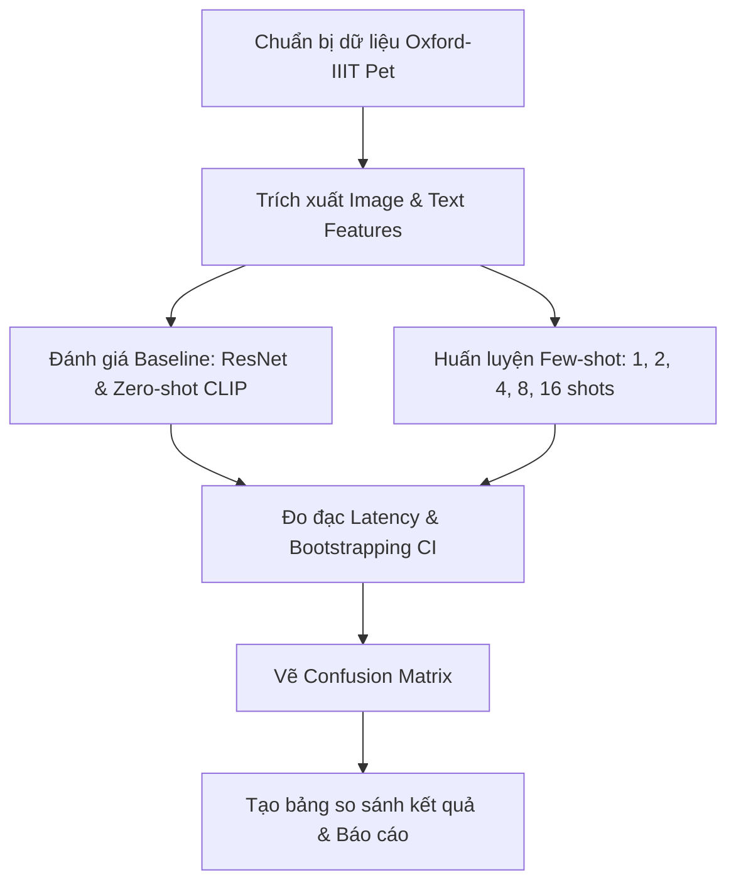

# Quy trình đánh giá (Evaluation Workflow) - CLIP Animal Classifier

Tệp tài liệu này định nghĩa quy trình chuẩn hóa từ bước chuẩn bị dữ liệu đến khi xuất kết quả báo cáo thực nghiệm so sánh các phương pháp phân loại giống vật nuôi.

---

## Các bước thực hiện chi tiết

### Bước 1: Chuẩn bị Dữ liệu
1. Tải tập dữ liệu Oxford-IIIT Pet qua `torchvision.datasets.OxfordIIITPet` vào thư mục `./dataset/`.
2. Phân chia tập dữ liệu thành:
   * **Test Set**: Tập dữ liệu chuẩn để đánh giá hiệu năng (sử dụng tập test mặc định của Oxford-IIIT Pet gồm ~3,700 ảnh).
   * **Support Set (Few-shot)**: Với mỗi mốc $N \in \{1, 2, 4, 8, 16\}$, thực hiện lấy mẫu ngẫu nhiên có phân lớp (stratified sampling) chính xác $N$ ảnh cho mỗi class từ tập huấn luyện để làm dữ liệu hỗ trợ.

### Bước 2: Trích xuất Đặc trưng (Feature Extraction)
1. Đóng băng mô hình CLIP (`openai/clip-vit-base-patch32`).
2. Trích xuất đặc trưng hình ảnh của Test Set và Support Set, lưu lại dưới dạng các file `.pt` (PyTorch tensors) để tránh việc phải chạy lại Encoder nhiều lần trong quá trình thử nghiệm.
3. Trích xuất đặc trưng của prompt text dựa trên cấu trúc prompt engineering đã chọn.

### Bước 3: Đánh giá Baseline
1. **ResNet Baseline**: Fine-tune lớp phân loại cuối của mô hình ResNet (ví dụ ResNet-50 pre-trained) trên toàn bộ tập train và đánh giá trên tập test.
2. **CLIP Zero-shot**: Sử dụng trực tiếp text features và test image features để tính accuracy.

### Bước 4: Chạy thí nghiệm Few-shot (Linear Probe & Tip-Adapter)
1. Với mỗi mốc shot $N$:
   * Lặp lại việc lấy mẫu Support Set **10 lần** khác nhau (sử dụng random seed khác nhau).
   * Chạy huấn luyện Linear Probe và thiết lập Cache cho Tip-Adapter trên từng support set.
   * Đánh giá hiệu năng phân loại trên Test Set.
   * Tính trung bình cộng accuracy của 10 lần chạy để có độ ổn định và giảm thiểu bias do lấy mẫu.

### Bước 5: Đo đạc Latency & Tính toán Khoảng tin cậy (CI)
1. Đo latency suy diễn trên từng phương pháp theo quy định tại `criteria/inference_latency.md`.
2. Sử dụng bootstrapping trên 10 lần lặp hoặc trên phân phối mẫu test để tính khoảng tin cậy 95% theo `criteria/confidence_interval.md`.

### Bước 6: Phân tích và Trực quan hóa
1. Tạo ma trận nhầm lẫn (Confusion Matrix) trên kết quả của mô hình tốt nhất (thường là Tip-Adapter ở 16-shot) để phân tích lỗi phân lớp (xem `criteria/confusion_matrix.md`).

### Bước 7: Tổng hợp báo cáo kết quả
Kết quả thí nghiệm cuối cùng phải được trình bày dưới dạng bảng so sánh sau:

| Phương pháp | Acc per shot (1, 2, 4, 8, 16 shots) | Confidence Interval (95% CI) | Inference Latency (CPU / GPU) | Mô tả chính |
| :--- | :--- | :--- | :--- | :--- |
| **ResNet Baseline** | N/A (Full Train) | [...] | [...] | Baseline CNN truyền thống |
| **CLIP Zero-shot** | [Acc]% (0-shot) | [...] | [...] | Chỉ sử dụng nhãn lớp đơn thuần |
| **CLIP + Prompt Eng**| [Acc]% (0-shot) | [...] | [...] | Bổ sung prompt ngữ cảnh |
| **CLIP + Linear Probe**| 1s: [..]%, 16s: [..]% | [...] | [...] | Huấn luyện đầu phân loại tuyến tính |
| **CLIP + Tip-Adapter**| 1s: [..]%, 16s: [..]% | [...] | [...] | Training-free few-shot cache |
